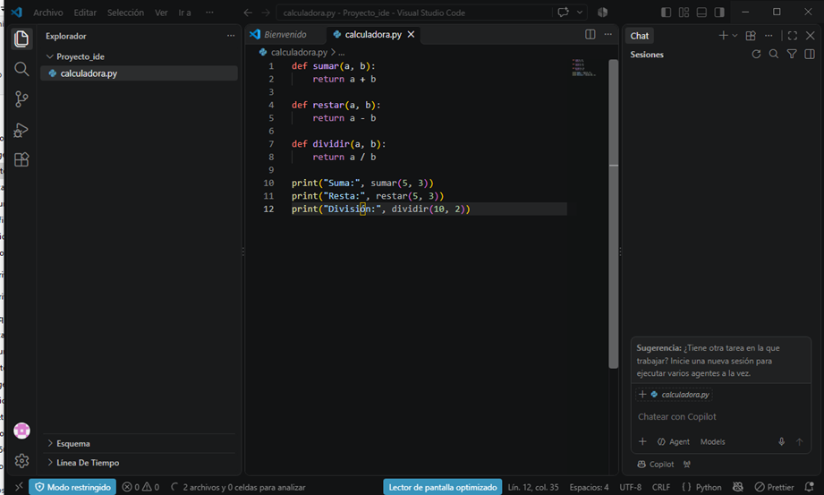
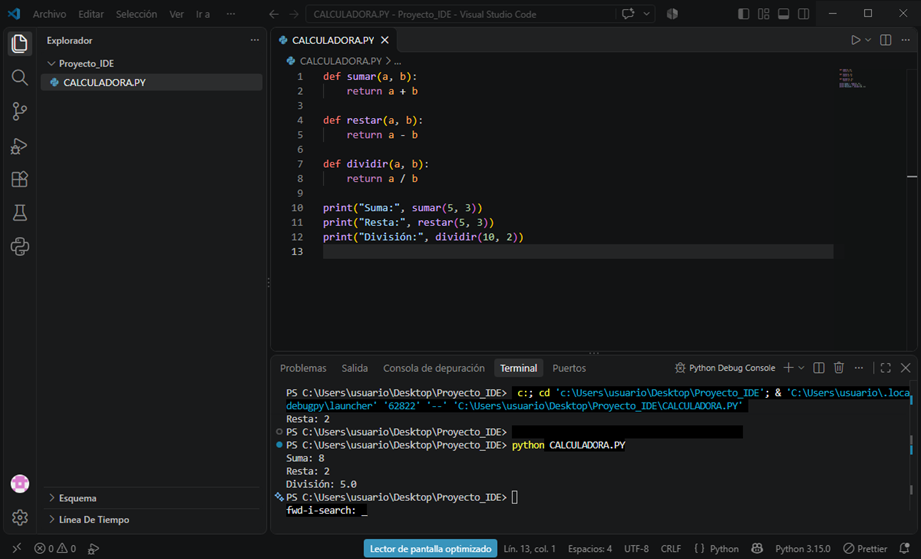
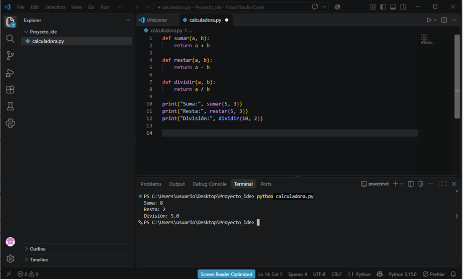
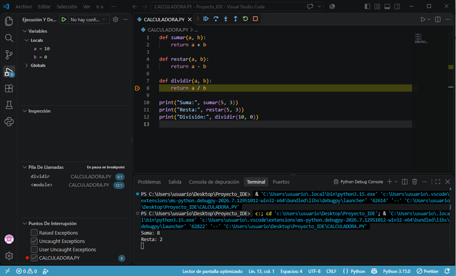
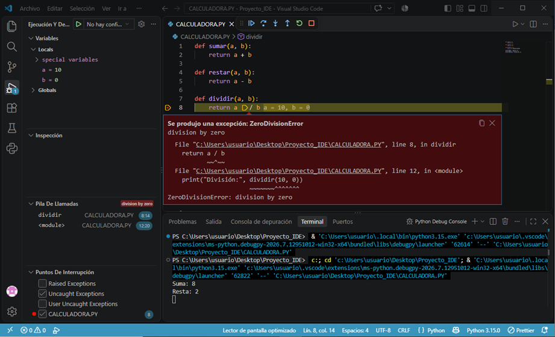
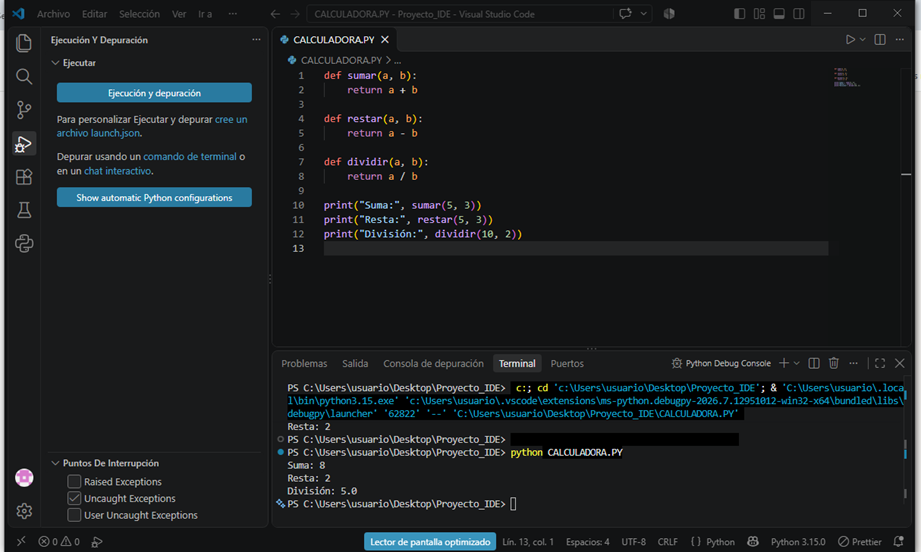
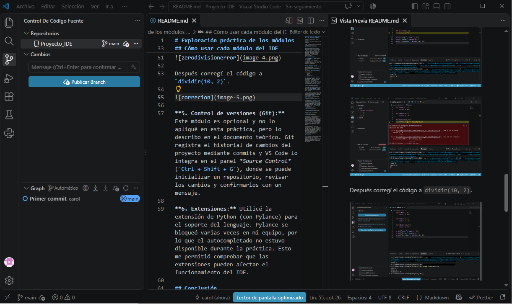

# Exploración práctica de los módulos de un IDE: Calculadora en Python

**Autor:** Carol Jineth  Neira Buitrago

**Curso:** Tecnico en codificación de software

**IDE utilizado:** Visual Studio Code
**Lenguaje:** Python 3.15

## Descripción del proyecto

Este proyecto es una calculadora básica en Python con tres funciones: `sumar`, `restar` y `dividir`. Se desarrolló para explorar los módulos principales de un IDE (editor, explorador de archivos, terminal, depurador, control de versiones y extensiones) y aplicarlos en un proyecto simple.

## Archivos del proyecto

- `CALCULADORA.PY`: código fuente de la calculadora.
- `README.md`: este documento.
- Documento teórico con la descripción de cada módulo.
- Capturas de pantalla del editor, la terminal y el depurador.

## Cómo ejecutar el programa

1. Abrir la carpeta `Proyecto_IDE` en Visual Studio Code.
2. Abrir la terminal integrada con `` Ctrl + ` ``.
3. Ejecutar: `python CALCULADORA.PY`

Salida esperada:

    Suma: 8
    Resta: 2
    División: 5.0

## Cómo usar cada módulo del IDE

**1. Editor de código:** Escribí las funciones de la calculadora en el editor de VS Code. Observé el resaltado de sintaxis, que muestra con colores distintos las palabras reservadas (`def`, `return`, `print`), las cadenas de texto y los números. 

**2. Explorador de archivos:** Lo usé para crear la carpeta `Proyecto_IDE` y el archivo `CALCULADORA.PY`, y para tener organizados todos los archivos de la entrega.

**3. Terminal integrada:** Ejecuté el programa directamente desde VS Code con el comando `python CALCULADORA.PY`, sin necesidad de abrir otra ventana. 

**4. Depurador:** Provoqué un error intencional llamando a `dividir(10, 0)`. Puse un breakpoint en la línea `return a / b`, inicié la depuración con *Python Debugger* y el programa se detuvo en esa línea. En el panel de Variables vi que `a = 10` y `b = 0`, lo que explica el error `ZeroDivisionError`. 

Después corregí el código a `dividir(10, 2)`.

**5. Control de versiones (Git):** Inicialicé un repositorio desde el panel *Source Control* de VS Code y realicé un primer commit con el mensaje "Primer commit", lo que guarda el estado actual del proyecto y permite volver a él más adelante.

**6. Extensiones:** Utilicé la extensión de Python (con Pylance) para el soporte del lenguaje. Pylance se bloqueó varias veces en mi equipo, por lo que el autocompletado no estuvo disponible durante la práctica. Esto me permitió comprobar que las extensiones pueden afectar el funcionamiento del IDE.

## Conclusión

La práctica me permitió entender cómo cada módulo del IDE facilita el desarrollo: el editor ayuda a escribir código, la terminal a ejecutarlo, el depurador a encontrar errores y las extensiones a ampliar las funciones del entorno.